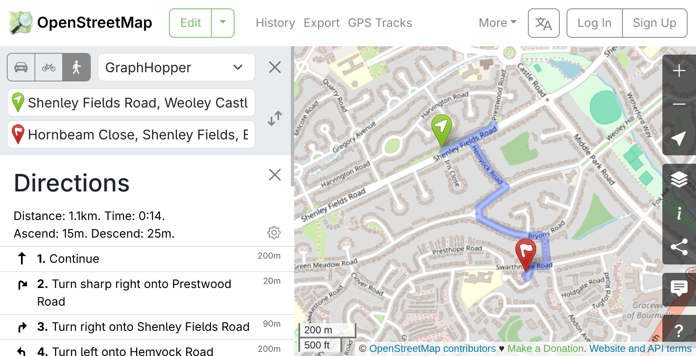
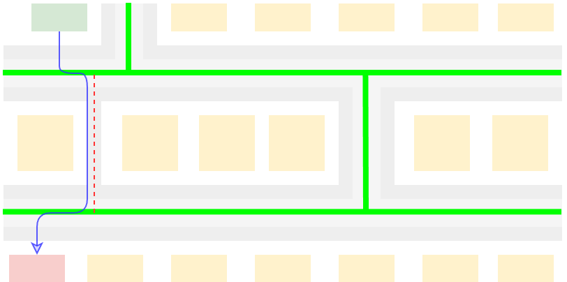
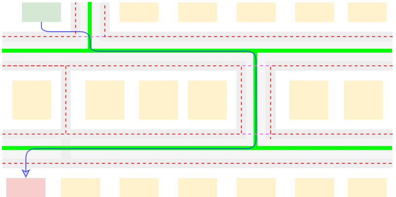
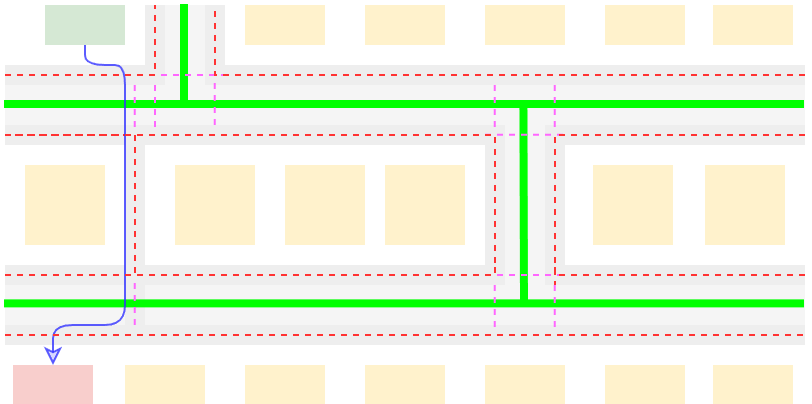
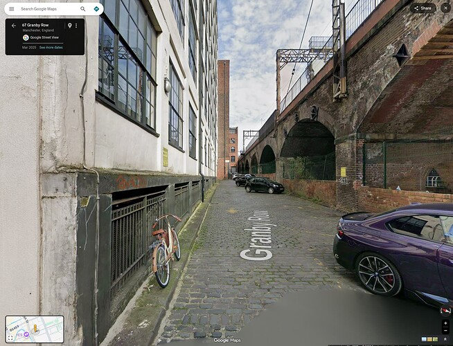

While never really catching up for cars, OpenStreetMap used to be _the best_ place for pedestrian mapping and routing over the past few decades. All sorts of footpaths and cut-throughs which were never added to Google Maps have been dilligently mapped by enthusiastic locals who know their areas like the backs of their hands, and were willing to go out - with GPS receivers, back when phones weren't reliable enough - then add in the tracks, tagging them as appropriate. This made OsmAnd, my choice of pedestrian navigation app, incredibly effective at plotting efficient routes through cities. By contrast, Google Maps would tend to send you down pollution corridors - large, arterial roads and the like - because Google generally maps the UK by car only.

This has started to change, due mainly to a well-intentioned push to add detail which is, nethertheless, corrupting OpenStreetMap.

# A classic OpenStreetMap win for pedestrians

Using cut-throughs speeds up pedestrian routing

Above is a good example of how OpenStreetMap can outpace Google Maps for pedestrians - this route between two locations near my old house is marked as 20 minutes on Google Maps, while only being 12 minutes on OpenStreetMap. You might say to me _"Well James, Google Maps clearly has that cut-through as well"_ and YES, dear reader, IT DOES NOW! But despite Google knowing that I lived there at the time, they repeately refused attempts by me to add the damned thing! Such is the arbitrary nature of Google Maps - edits can be stuck pending, or refused outright, based on a very aggravating and opaque process.

This is where OpenStreetMap really shines - locals adding little bits here and there, that flesh out the map with their local understanding of the area. Let's look at some current examples of these which still haven't been added to Google Maps:

Footpaths around Green Square avoiding a 7 minute detour (though Google Maps will attempt to send you up locked ginnels instead)

A cut-through to Lancaster Road avoiding a 7 minute detour

An alleyway to Stafford Avenue avoiding a 10 minute detour

These aren't only nice little time-savers between arbitrary locations - routers using OpenStreetMap will generally produce shorter routes which go through parks and quieter roads, well away from the "pollution corridors" of main roads that Google Maps will more often pick.

Or at least it *did*.

# A modern OpenStreetMap loss for pedestrians

A clue as to the issue

Above is the same example as earlier, except I moved the starting point north of Shenley Fields Road (previously it was on the south). Notice the weird bit where it goes too far along the road before coming back on itself? Let's zoom in there:

A separated pavement running along the north side of Shenley Fields Road

What's happened here is that someone has added a footpath along the side of the road (to represent the pavement) and since this is the closest way to our starting point that a pedestrian can use, the route is starting from here. From there, the router cannot join the road way until it goes along to the crossing (at which point it hops off the footpath and into the "road").

This is intentional, and is a type of mapping called "separated sidewalks" (most of OSM uses British English, pavements are an exception). Instead of tagging whether a "sidewalk" exists on each side of a road (similar to how we tag lanes, speed limits etc) the sidewalk is placed as a separate way, linked to the road at crossing points. This works well with pedestrian laws ("Jaywalking") in some jurisdictions, and can be helpful where sidewalk geometry deviates significantly from that of the carriageway, e.g:

The carriageway continues, while the pavement goes off to the side, under the ramp, and then goes under the roadway (though you can also emerge via the service road to that building with the circles on the side).

The carriageway continues (apparently directly into the sun) while the pedestrians head left down that separate tunnel.

Shenley Fields Road is a simple road with a small grass verge separating the carriageway from the pavement - not exactly a great example of "significant deviation" - but hey, no big deal, right? Not really, not in this instance. But take a look at this:

A large detour, this is actually a 4 minute walk

This route takes four minutes to walk, but with the sidewalks added this increases to twelve minutes - *three times the length* - and not on busy roads at all. Now looking at the map you might realise immediately that something is up, but if you were just looking for journey times you would be sorely misinformed about the length of this trip - and overwhelmed by any series of directions to get you there!

Closer to my heart, we also lose lovely little shortcuts such as this one, as the map ironically now glues you to the road:

Marooned by sidewalks, here we're taking the long way around

# When more detail is less detailed

Let's consider what happened here. First, let's look at a representation of an aerial view with no mapping applied.

Aerial view of some houses and streets, with no mapping applied

And then let's fast-forward to the "golden age" - where roads had been added to most roads in the UK, and the "cut-through" footpaths were starting to be added in:

Roads applied in green, footpaths applied in dashed red, pedestrian routing in blue

You can imagine that someone came along here and added the roads, and then someone else came along and added that little footpath (because they knew it was there). It was easy for them to add, too - just connect the footpath to both roads - and it improved the quality of the map! This golden age of little tweaks made pedestrian routing a joy.

Now let's see what has happened in the era of separated sidewalk mapping, and how it affects the routing:

Separated sidewalks in dashed red, crossings in dashed purple

This is a pretty typical example of separated sidewalk mapping (though note that it's better than many examples in the wild) - we've added a "footway" for every sidewalk on the road, and we've added in crossings where roads terminate at T-junctions. And we can see the problem - the router, now trying to follow these sidewalks, cannot "reach" the other side of roads! This results in the incredibly common "degrading" of the route down to the road, but note that because the footpath has now been hooked up to the separated sidewalks the router resolves to just "pretend to be a car".

# But James, we can fix this

Pragmatically, we can absolutely fix this - by adding in "crossings" wherever a sidewalk meets a road:

The footpath and all the sidewalks now continue out across the road

But what I've done here is controversial in the OpenStreetMap world - the crossings I added don't really "exist", they're just being drawn in as shorthand for the road being crossable (arguably, [Mapping for the Router](https://wiki.openstreetmap.org/wiki/Tagging_for_the_router#Desire_paths)). Worse, the goal of separated sidewalks is often accessibility - but these crossings are not neccessarily accessible, and you can't easily indicate where they aren't (e.g. you can indicate a lowered or raised kerb, but [proposals for a "regular" kerb have been rejected](https://wiki.openstreetmap.org/wiki/Proposal:Kerb=regular)).

It also requires a *lot* more rigour than the "golden age", where adding a footpath was simply connecting two roads up with a new way. Adding separate sidewalks to streets requires meticulous consideration of how pedestrians might use a road to ensure that the additions keep at least the same utility (and hopefully more!) than the previous, integrated examples.

And this just doesn't work very well with the sort of project OpenStreetMap is. Mappers, by and large, aren't professionals - they're just scratching their own itches, iteratively improving the map for everyone as they improve it for themselves. 

# Other solutions (which won't be discussed)

* **Mapping only _some_ pavements.** Many people in the OSM community don't believe all sidewalks should be mapped at all, and instead we should stick to mapping only distinct geometry (e.g. where a sidewalk deviates from a road). Another approach is to only map separated sidewalks where they are alongside roads that are hard to cross (and so a diversion to a physical crossing is more useful).
* **Bundling components of a road together.** OpenStreetMap was not really designed to express "complex ways" (one reason why lanes of a road aren't mapped) - an update to the underlying schema which allows for related ways to be grouped together - and so, routed between - would neatly solve many of the problems with separated sidewalks.
* **Only mapping pavements in specific areas.** It is notable that separated sidewalks aren't *universally* bad. Paris is often called out as having good separate sidewalk mapping (which I understand to be down to their active local community), and in other parts of the world municipal datasets have been made available that allow for accurate large-scale imports. And of course, where "Jaywalking" is a crime, maybe the map should reflect only legal crossings!

There isn't much appetite for any of this, however. Sidewalks have become an incredibly contentious subject in the OpenStreetMap community, where there is a consistent pattern of people raising issues with the status quo then being accused of acting in bad faith. This has been exacerbated by some "activist" mappers targeting the areas of people raising issues, adding (generally badly) separated sidewalks to their area.

Worse, Facebook got involved.

# The Meta problem

Facebook's ["walkabout" initiative](https://wiki.openstreetmap.org/wiki/Organised_Editing/Activities/Meta/Pedestrian_Mapping) has been a particularly prolific source of poor quality sidewalk mapping. Their approach has been to "challenge" remote mappers to add them in, which is generally done using (fairly old) aerial imagery and (fairly sparse) [Mapillary](https://www.mapillary.com/) street views. This initiative has put down an overwhelming amount of sidewalk ways across Manchester, where I now live, leading to a noted degradation in pedestrian mapping in the city.

This bicycle is parked on a pavement, according to Facebook

The status quo in OpenStreetMap is that you cannot delete a sidewalk if it exists - you can only improve it. So if you find yourself in an area where separated sidewalks have been placed, your only option is to *"draw the rest of the owl"* - all the little connections that we talked about above, which make the map routable for pedestrians again. This was not really a big problem at first - individual volunteers could only do so much, so there was only so much to fix - but with initiatives like the walkabout whole cities were having large networks of sidewalks dropped down in short order, certainly more quickly than local mappers could object.

And if you excuse the conspiratorial tone to this next bit: this is possibly by design.

Or at least - the combination of a large glut of new, badly mapped sidewalk ways, combined with the drowning out of objections to the separated sidewalk mapping approach, seem to conspire to force local mappers to do the large amount of fixup work if they want their local maps to return to the functionality they previously had.

# The Google solution

Regardless of the intent, this probably isn't what's going to happen. I am a fairly avid supporter of free and open source software, but even I have been put off by this - and truth be told, I use Google Maps again now. They have caught up in many ways with the little routes OSM excelled at, and while I could "knuckle down" I don't really believe that OSM can muster the volunteer army necessary to make the current approach successful (at least, not outside of an externally sourced dataset).

I think what I need to do is step back and consider things more holistically - I think that an open source map is valuable, and I'd like to contribute to that - but I think it's more valuable that I have a reliable walking map that keeps me from driving places, and I don't want to get in (more) arguments with people on the internet.

In that sense, and for now, Google Maps is better for me.