While never really catching up for cars, OpenStreetMap used to be _the best_ place for pedestrian mapping and routing over the past few decades. All sorts of footpaths and cut-throughs which were never added to Google Maps have been dilligently mapped by enthusiastic locals who know their areas like the backs of their hands, and were willing to go out - with GPS receivers, back when phones weren't reliable enough - then add in the tracks, tagging thm as appropriate. This made OsmAnd, my choice of pedestrian navigation app, incredibly effective at plotting efficient routes through cities. By contrast, Google Maps would tend to send you down pollution corridors - large, arterial roads and the like - because Google generally maps the UK by car only.

This has started to change, due mainly to a well-intentioned push to add detail which is, nethertheless, corrupting OpenStreetMap.

# A classic OpenStreetMap win for pedestrians

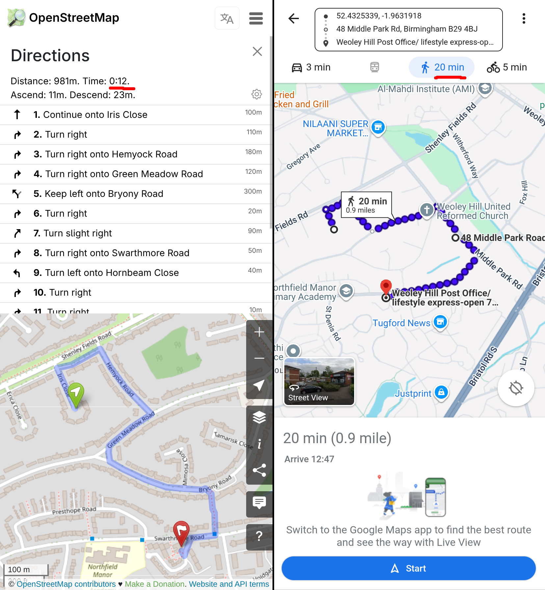

Using cut-throughs speeds up pedestrian routing

Above is a good example of how OpenStreetMap can outpace Google Maps for pedestrians - this route between two locations near my old house is marked as 20 minutes on Google Maps, while only being 12 minutes on OpenStreetMap. You might say to me _"Well James, Google Maps clearly has that cut-through as well"_ and YES, dear reader, IT DOES NOW! But despite Google knowing that I lived there at the time, they repeately refused attempts by me to add the damned thing! Such is the arbitrary nature of Google Maps - edits can be stuck pending, or refused outright, based on a very aggravating and opaque "computer says no".

This is where OpenStreetMap really shines - locals adding little bits here and there, that flesh out the map with their local understanding of the area. Let's look at some current examples of these which still haven't been added to Google Maps:

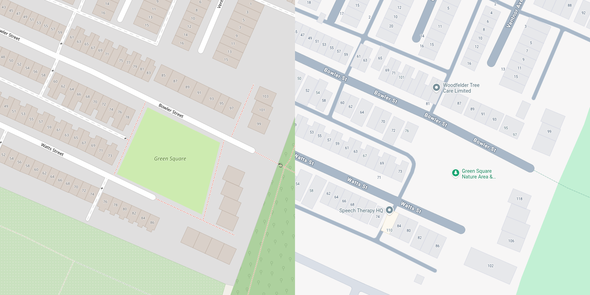

Footpaths around Green Square avoiding a 7 minute detour (though Google Maps will attempt to send you up locked ginnels instead)

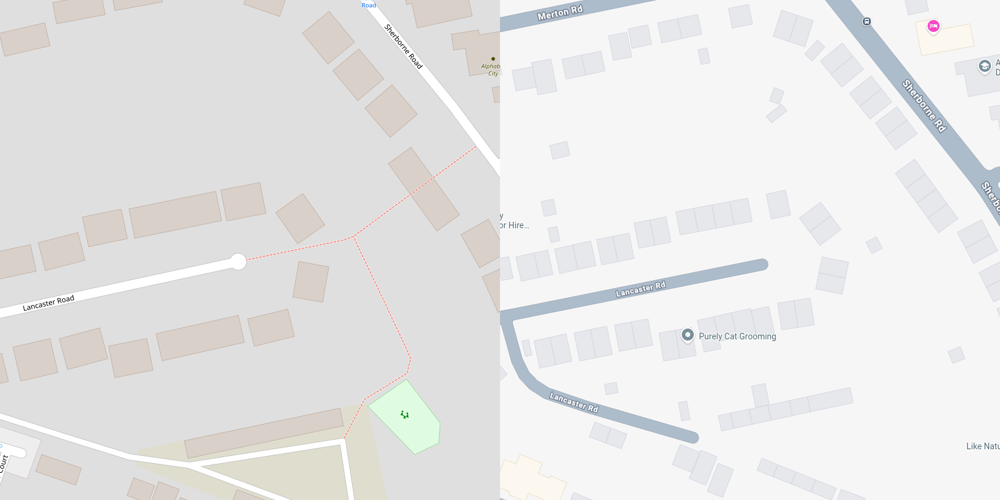

A cut-through to Lancaster Road avoiding a 7 minute detour

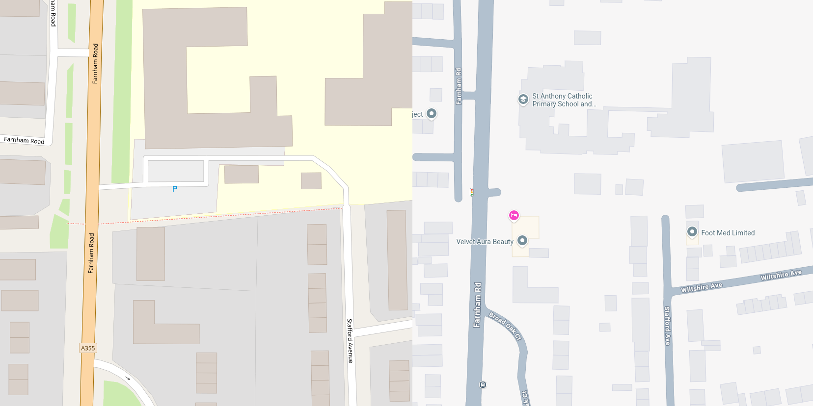

An alleyway to Stafford Avenue avoiding a 10 minute detour

These aren't only nice little time-savers between arbitrary locations - routers using OpenStreetMap will generally produce shorter routes which go through parks and quieter roads, well away from the "pollution corridors" of main roads that Google Maps will more often pick.

Or at least it *did*.

# A modern OpenStreetMap loss for pedestrians

Using cut-throughs speeds up pedestrian routing

Above is the same example as earlier, except I moved the starting point north of Shenley Fields Road (previously it was on the south). Notice the weird bit where it goes too far along the road before coming back on itself? Let's zoom in there:

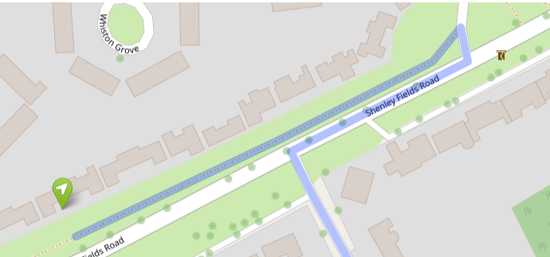

A separated pavement running along the north side of Shenley Fields Road

What's happened here is that someone has added a footpath along the side of the road (to represent the pavement) and since this is the closest way to our starting point that a pedestrian can use, the route is starting from here. From there, the router cannot join the road way until it goes along to the crossing (at which point it hops off the footpath and into the "road").

This is intentional, and is a type of mapping called "separated sidewalks" (most of OSM uses British English, pavements are an exception). Instead of tagging whether a "sidewalk" exists on each side of a road (similar to how we tag lanes, speed limits etc) the sidewalk is placed as a separate way, linked to the road at crossing points. This works well with pedestrian laws ("Jaywalking") in some jurisdictions, and can be helpful where sidewalk geometry deviates significantly from that of the carriageway, e.g:

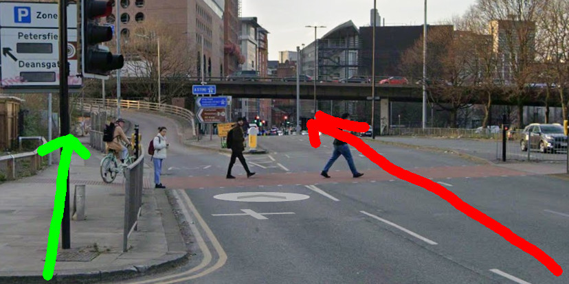

The carriageway continues, while the pavement goes off to the side, under the ramp, and then goes under the roadway (though you can also emerge via the service road to that building with the circles on the side).

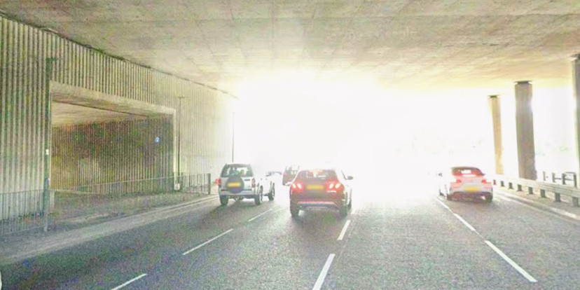

The carriageway continues (apparently directly into the sun) while the pedestrians head left down that separate tunnel.

Shenley Fields Road is a simple road with a small grass verge separating the carriageway from the pavement - not exactly a great example of "significant deviation" - but hey, no big deal, right? Not really, not in this instance. But take a look at this:

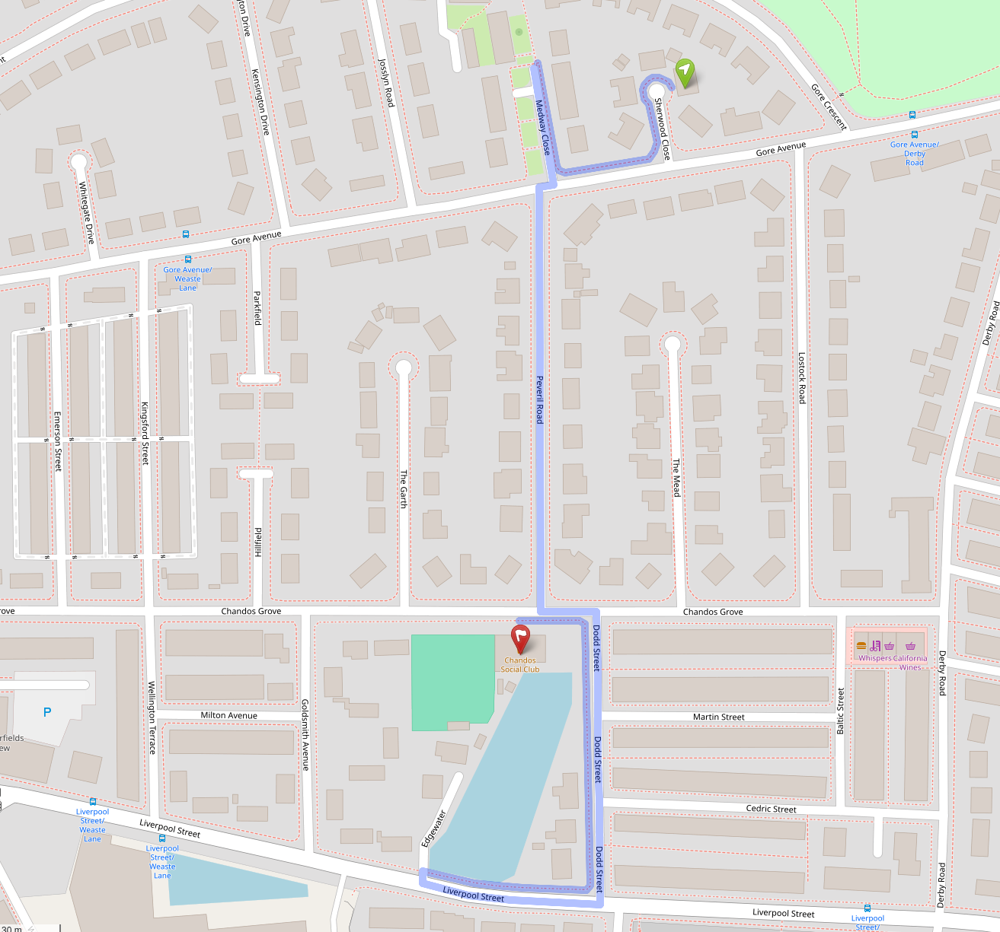

A large detour, this is actually a 4 minute walk

This route takes four minutes to walk, but with the sidewalks added this increases to twelve minutes - three times the length - and not on busy roads at all. Now looking at the map you might realise immediately that something is up, but if you were just looking for journey times you would be sorely misinformed about the length of this trip. Worse, we lose lovely little shortcuts such as this one:

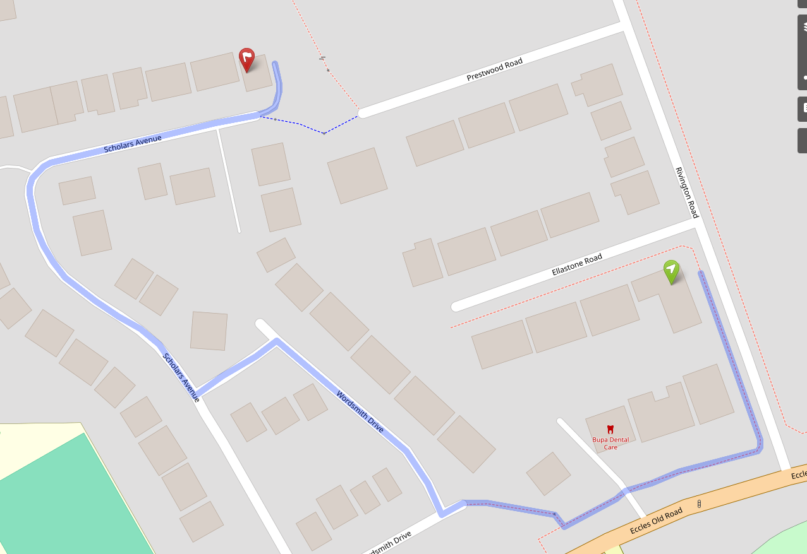

Marooned by sidewalks, here we're taking the long way around

# So what changed?

If we look closer we can see some clear problems here:

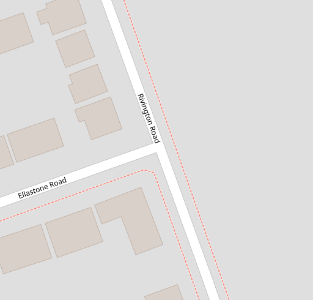

No crossing added at the junction, possibly because the other sidewalk wasn't added

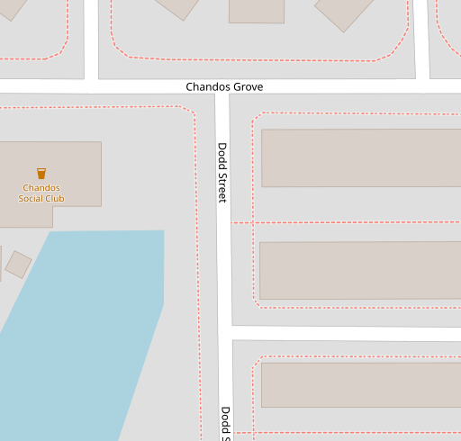

Connections to the road but not the other sidewalk

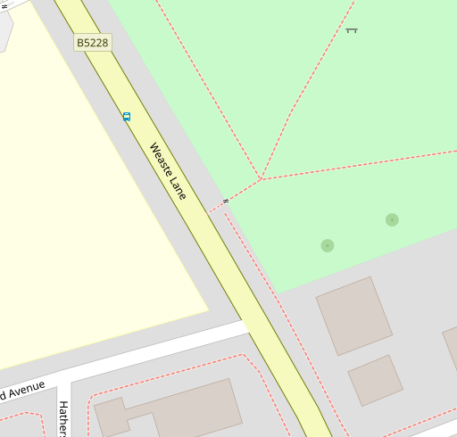

Ways not connected up (there's no obvious reason for this)

Unfortunately this is a very common occurence with separated sidewalks - and unlike other features in OSM, unless they're added carefully, they make the map worse than before they were added. These are the ways that need to be added to (almost) match the pedestrian functionality in an integrated pavement:

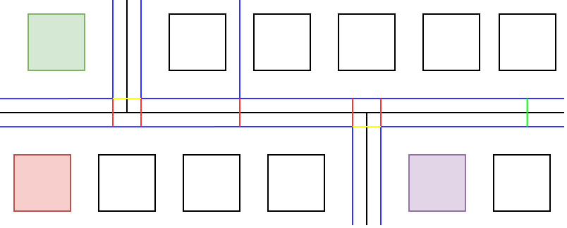

A road with two junctions

This road has four classes of "way" (connections between points):

 - The black lines are roads. These are the only ways that exist prior to separated sidewalks.
 - The blue lines are footpaths, mostly separated sidewalks. In some parts of the world these are all that exist, completely separated from any other way (and as such don't really cause much of a problem, unless they're somehow connected up at some point).
 - The green line is a marked crossing, which is often the only type of connection between sidewalks. These are often where a router will hop down to the road way, although the intention is to cross to the other sidewalk.
 - The yellow lines are "unmarked crossings", usually dropped kerbs (though in the UK pedestrians have right-of-way at junctions, so are often considered unmarked crossings even with the absence of a dropped kerb).
 - The red lines represent crossings that pedestrians are likely to take, although they are not technically crossings at all (a pedestrian would cross at any point along the road, but these crossing ways represent that well in most cases).

Even with all of these drawn in, routing can be a pain. For example, routing between the green and the purple building would be pretty representative, but between the green and the red building you would have to route along to the junction - this could be a short or a long detour! But in most cases these are just quirks, and if separated sidewalks were added with all of these ways included then there probably wouldn't be much of a problem. But since we don't, we have degraded functionality for pedestrians.

# What can we do about it?

For now, this seems to be here to stay. A vocal group in the OSM community take a pretty extreme position on this - that a sidewalk must not be deleted if it exists, even if it's causing problems for map users - and that position seems to be taken as the status quo for the time being. The idea is that they will be improved over time, although many of the examples I gave above are now years old without any sign of improvement. Indeed, the focus seems to have been on remote mappers drawing in the basic structure of sidewalks based on aerial imagery, and in Manchester many of the newer separated sidewalks have been added in bulk through Meta's "Walkabout" Pedestrian Mapping Initiative (which focuses on "mapping with Al" to get more sidewalks laid down).

(I'd like to note here that the justification is mainly on accessibility grounds - that separated sidewalks are better for people e.g. in wheelchairs - but in practice the quality of the mapping is so poor it can't reasonably be relied on for accessible routing)

This focus on quantity over quantity is possibly done in the hope that local mappers, annoyed with the map being degraded, will jump in and fix any problems - but the sheer quantity of work required as well as the knowledge that *it worked fine before* probably puts people off (as it puts me off). The pragmatic solution is to delete the badly mapped sidewalks entirely (and those with the interest in this sort of mapping to do it again in a way that is more neighbourly) but as noted, this probably isn't possible without getting into some nasty edit wars.

So I think the thing to do, for now, is to just be aware that this is a problem in tools that use OpenStreetMap. Keep an eye out for weird routes and study the map for shortcuts instead of relying on routers to do it for you.

Mostly, try not to get back in a car. Walking is good, keep it up :)